# 12-bit SAR ADC for Biomedical Applications (90 nm CMOS)

Schematic-level design and simulation of a low-power 12-bit, 1 kS/s successive-approximation ADC for low-frequency biomedical signals (ECG / EEG / EMG range), built in **Cadence Virtuoso + Spectre** using the **GPDK090 (90 nm)** process at a **1 V** supply.

B.Tech major project, Dept. of ECE, IIIT Senapati, Manipur (Aug - Nov 2026). Supervisors: Dr. Nagesh Ch, Dr. Dilip Singh.

**Team:** Chirag Verma, Kishan Kumar Singh

## Architecture

| Block | Implementation |
|---|---|
| Sample & Hold | Auxiliary-capacitor bootstrapped switch (C2 = 800 fF, CB = 1 pF) |
| Comparator | Double-tail dynamic comparator |
| DAC | 12-bit R-2R ladder (R = 10 kΩ, 2R = 20 kΩ) |
| SAR logic | Synchronous, D flip-flop based (26 DFFs: shift register + result register) |

Conversion timing: 1 sampling cycle + 12 decision cycles, so `f_clk = 13 kHz` for `f_s = 1 kS/s`.

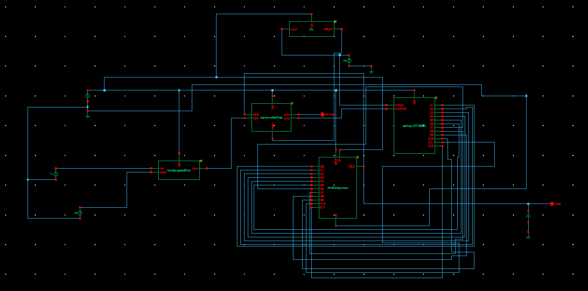

## Simulated results (integrated ADC, schematic level)

| Metric | Target | Result |
|---|---|---|
| Average power | < 10 µW | **8.4025 µW** |
| ENOB | ≥ 11 bits | **11.8 bits** |
| SNDR | ≥ 72 dB | **72.796 dB** |
| Max abs. DNL | < 1 LSB | 0.35 LSB (verification pending) |
| Max abs. INL | < 1 LSB | 0.33 LSB (verification pending) |
| Walden FoM (ENOB basis) | - | 2.36 pJ/conversion-step |

Dynamic test: coherent sine, 0.5 V offset, 0.49 V amplitude, f_in = 476.5625 Hz (N = 128, M = 61), f_s = 1 kS/s, VDD = 1 V, 27 °C.

Compared with my minor project (conventional bootstrapped switch + capacitive DAC): power 9.8 → 8.4 µW, SNDR 64.66 → 72.8 dB, ENOB 10.4 → 11.8, max INL 3.28 → 0.33 LSB. Max DNL went from 0.23 to 0.35 LSB, so not every metric improved.

## Block-level work

**Bootstrapped sample-and-hold** keeps V_GS of the switch roughly constant so on-resistance does not vary with the input.

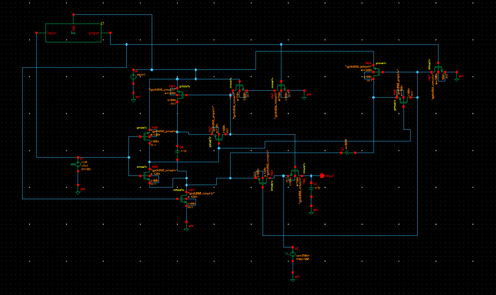
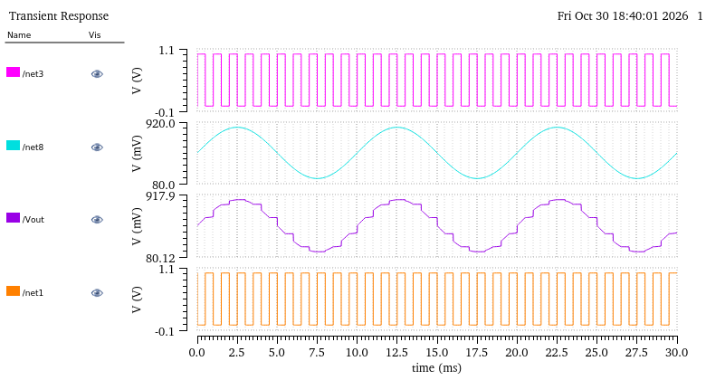

**Double-tail dynamic comparator**: separate input and latch stages, no static power.

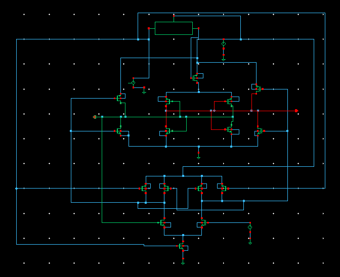
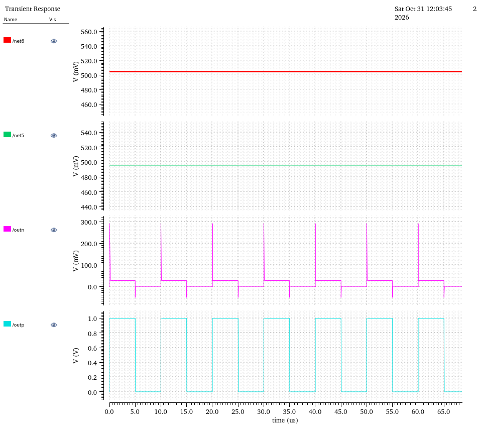
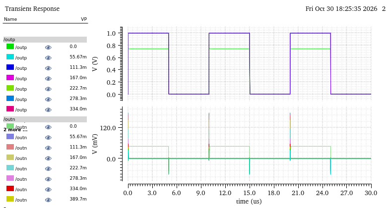
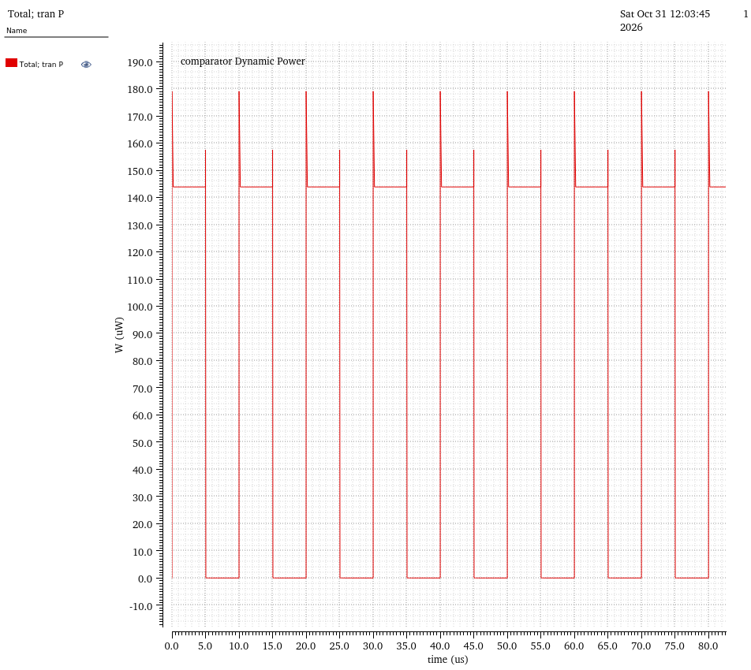

**12-bit R-2R DAC**

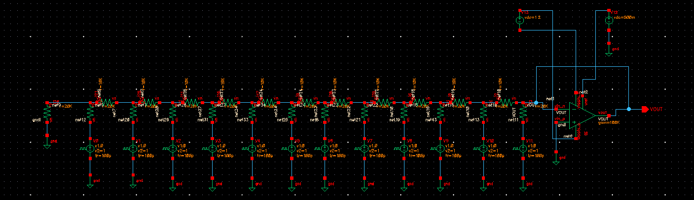
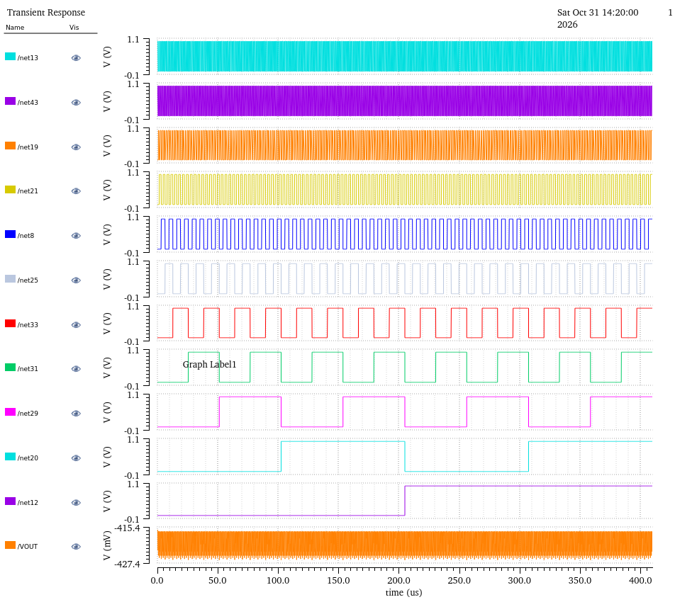

**Synchronous SAR logic**: bits resolve MSB to LSB, one per clock.

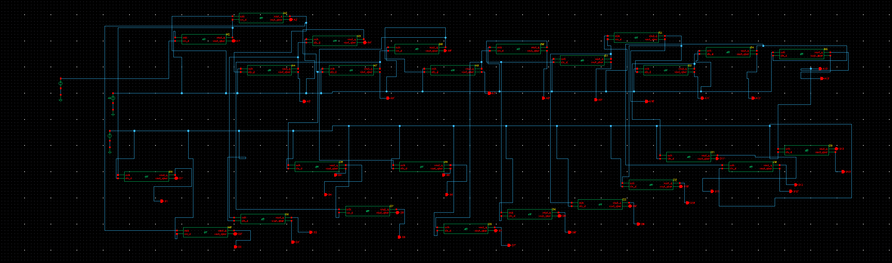
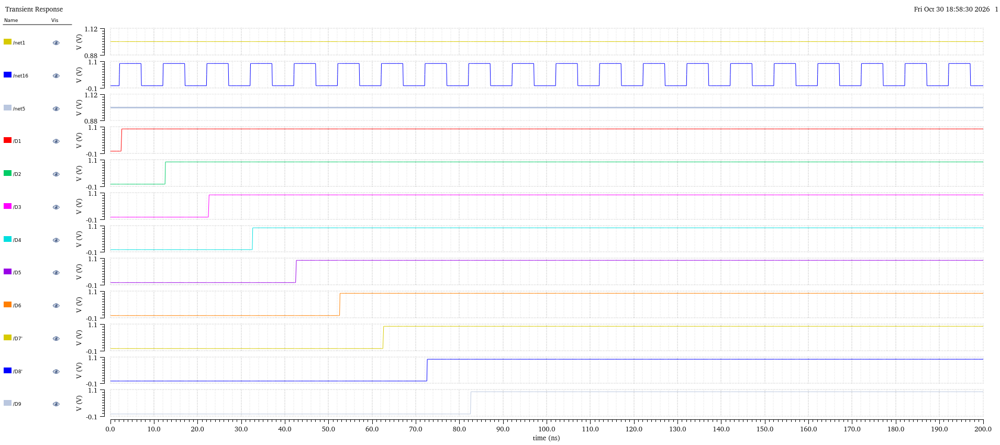

**Integrated ADC**

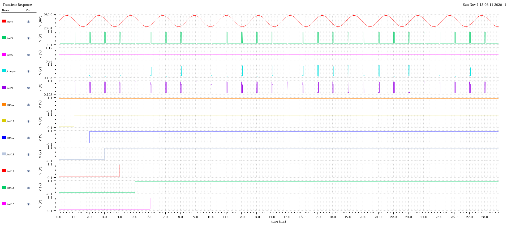
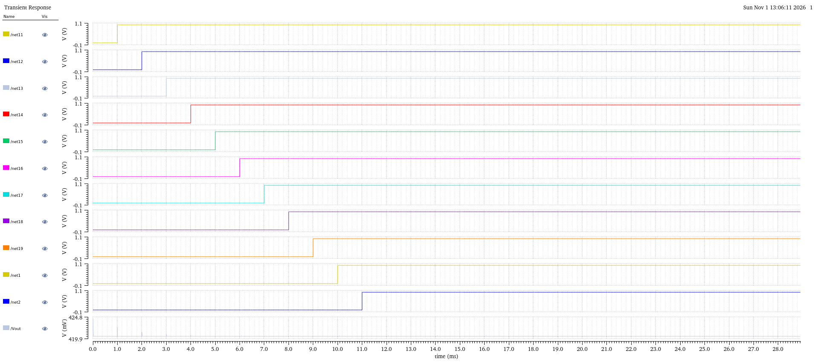
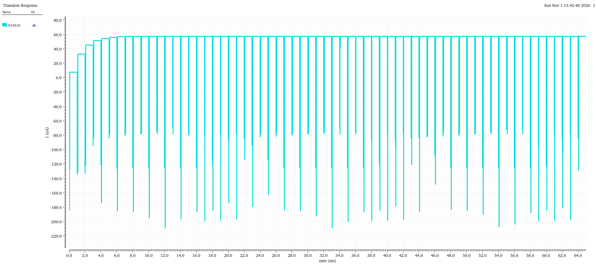
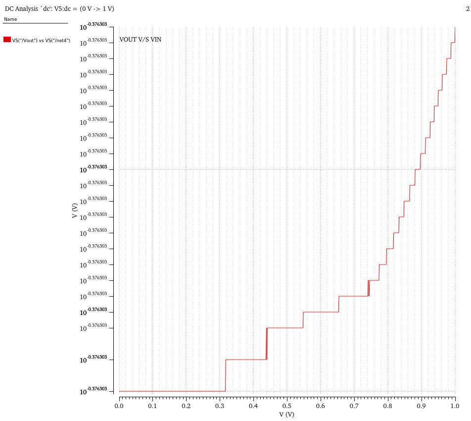

The last plot is the ADC output response to a 0-1 V sweep. It is not a full 4096-code DNL/INL plot.

## Test setup (full ADC)

- VDD = 1 V core; 1.2 V separate supply for the DAC output buffer (testbench only)
- SAR clock 13 kHz (t_clk = 76.923 µs); comparator clock = inverted SAR clock
- Bootstrap sampling pulse: period 1 ms, width 76.8 µs
- Transient max step 2 µs
- Full testbench tables: Appendix A of the report in `docs/`

## Known limitations

Stated openly in the report as well:

- Schematic-level simulation only. No layout, post-layout, or silicon measurement.
- PVT corners and full-ADC Monte Carlo not completed.
- DNL/INL values are recorded maxima; the full 4096-code transition data is not included.
- Comparator offset (0.56 mV) and delay (14.5 µs) are recorded but not independently verified.
- Tested with a near-full-scale sine, not a real ECG waveform.
- Sampling capacitor value and transient-noise setting for the full-ADC run were not recorded.
- Compared with the 130 nm measured-silicon reference (Mao et al.), this design has a worse FoM (2.36 pJ vs 0.076 pJ per step) and different validation basis, so it is not a like-for-like comparison.

## Repository structure

```
docs/       Final project report (PDF)
images/
  schematics/   Block and top-level schematics (Cadence Virtuoso)
  results/      Spectre simulation waveforms
```

The GPDK090 PDK / model files are proprietary and are **not** included.

## Tools

Cadence Virtuoso, Spectre, ADE Explorer, GPDK090 (nmos1v / pmos1v), Verilog-A (D flip-flop model)

## References

1. W. Mao, Y. Li, C.-H. Heng, Y. Lian, "A low power 12-bit 1-kS/s SAR ADC for biomedical signal processing," IEEE TCAS-I, vol. 66, no. 2, 2019.
2. J. Zhou, Z. Guo, S. Liu, R. Xu, "A 94.52 dBc SFDR 89.86 dB SNDR high-linearity bootstrapped switch for SAR ADC," IEICE Electronics Express, vol. 23, no. 6, 2026.
3. Full list in the report.

## Author

Chirag Verma, ECE, IIIT Senapati | [LinkedIn](https://www.linkedin.com/in/chirag-verma-a650bb202/)
